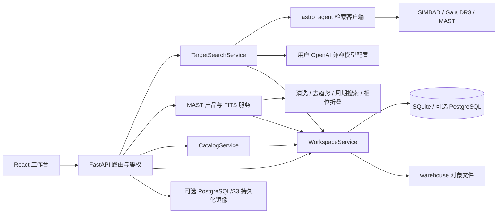

# 交互式目标信息与光变曲线工具架构

本文按 2026-10-28 本地源码整理，替换早期“无数据库骨架”设计。线上部署使用仓库内 `backend/app/portal.py` 的门户适配，具体路径、核验结果和限制见 [部署文档](DEPLOYMENT.md)；本地开发见 [README](../README.md)。

## 代码分层



| 入口 | 职责 |
| --- | --- |
| `run_agent.py`、`src/astro_agent/cli.py` | CLI 批量检索、配置加载及 JSON/Markdown/TXT 报告输出 |
| `src/astro_agent/agent.py`、`clients/` | 目标解析、天文数据库客户端、文献规则归纳、模型客户端 |
| `backend/app/main.py` | 业务 API、启动初始化、健康检查和前端静态文件 |
| `backend/app/workspace_routes.py`、`auth.py` | 账号、会话、CSRF、管理员与用户私有模型接口 |
| `services/target_service.py` | 目录快照优先读取、旧报告兼容、科学查询和用户私有 AI 运行 |
| `services/workspace_service.py` | SQLAlchemy 关系模型、账户/会话、对象索引、密钥加密、迁移台账 |
| `services/persistence_service.py` | 可选 PostgreSQL 元数据及 S3/MinIO 对象镜像 |
| `services/lightcurve_archive_service.py` | MAST TESS/Kepler/K2 产品搜索、筛选和下载 |
| `services/lightcurve_fits_service.py` | FITS 通量列选择、质量过滤、CSV/点列转换 |
| `services/lightcurve_service.py` | 数值清洗、去趋势、Lomb-Scargle 周期搜索和相位折叠 |
| `services/lightcurve_cache_service.py` | 文件锁、搜索/产品/派生/分析缓存、完整性检查与清理 |
| `services/catalog_service.py` | 数据管理关系视图、旧目录扫描与兼容清单 |
| `frontend/src/` | React 工作台、API 封装、状态 hooks、Plotly/Recharts 可视化 |

CLI 与 Web 复用科学客户端，但持久化和账号流程不同。CLI 仍按目标写 `results/<safe-target>.json/.md/.txt`，不通过 Web 登录；同名报告可能覆盖。Web 新快照由工作台目录库索引，AI 输出按用户单独保存。

## 身份与权限

仓库原生模式使用本地账号，不提供公开注册。管理员通过管理 CLI 初始化，之后可在管理页面创建/停用用户、重置临时密码；临时密码要求修改后才能使用常规工作台功能。

- 密码使用 Argon2；会话以不透明 Cookie 标识，身份从目录数据库解析。
- Cookie 为 HttpOnly、SameSite=Lax；是否 Secure 由 `COOKIE_SECURE` 控制，独立 HTTPS 部署应核对配置。
- 已登录写请求通过 `X-CSRF-Token` 校验；登录本身无需已有 CSRF Token。
- 普通用户可读取共享科学数据，发起查询、刷新、下载、分析，并管理自己的模型配置/运行历史。
- 共享数据删除、缓存清理、修复和目录重建保留管理员边界。模型配置、密钥和 AI 输入/输出按所有者隔离。

**当前生产模式**在 `backend/app/portal.py` 中覆盖原生身份依赖，接收门户网关校验后覆盖注入的身份头，建立门户用户到本地工作区的关联。门户超级管理员映射为工作台管理员；这层代码、systemd 模板和更新脚本现在均由仓库维护。不能把原生账号模式的部署步骤或身份假设直接套到线上。

## 权威存储与兼容目录

默认 `PERSISTENCE_BACKEND=sqlite-warehouse`：

```text
warehouse/
  db/target_info.sqlite                 # 关系目录、账号、会话、索引
  objects/targets/<target-id>/<snapshot-id>/
  objects/lightcurves/<target-id>/<dataset-id>/
  objects/llm/<user-id>/<target-id>/<run-id>/
  cache/{mast-search,products,derived,analysis,locks}/
  manifests/                            # 迁移报告、兼容 catalog 导出
  secrets/master.key                    # 本地模式的加密主密钥
results/                                # CLI 与旧版目标报告
data/                                  # 旧光变数据及运行缓存
```

`WAREHOUSE_ROOT` 可覆盖 warehouse 根目录，`WORKSPACE_DATABASE_URL` 可覆盖目录数据库地址。默认 SQLite 使用 WAL；不能把整个 warehouse 当可重建缓存。关系模型包括账号/会话、目标/别名/快照、文件/数据集/产品、用户模型配置/运行记录和迁移台账。

目标缓存读取顺序为工作台目录库中的快照 → 可选外部持久化 → 兼容 `results/` 文件。强制刷新访问科学数据库并保存新快照。共享科学快照与用户模型总结分开保存；模型失败不应丢失已获得的科学查询信息。

模型 API Key 使用 AES-GCM 加密。主密钥来自 `APP_MASTER_KEY`，SQLite 模式缺省时持久化为权限 `0600` 的 `warehouse/secrets/master.key`；外部数据库模式要求显式提供主密钥。备份必须保留能解密既有数据的同一密钥，不能重建一个新密钥替代。

可选 `postgres-s3` 模式使用 PostgreSQL 关系表和 S3/MinIO 对象镜像，本地仍需可寻址文件用于 FITS/数值计算。与默认模式有共享模型及兼容层，并不意味着所有本地目录均可直接丢弃；切换/恢复前须验证对象同步、目录记录和用户私有记录。当前 5 号机未启用该模式。

## 光变处理与缓存

1. 按目标名/坐标在 MAST 查询 TESS、Kepler、K2 timeseries 产品，筛选 light curve FITS。
2. 下载选中产品，使用锁、临时文件/目录及原子重命名避免并发半成品被读取。
3. 写入产品清单和数据集 manifest；默认数据集位于 `warehouse/objects/lightcurves/`，兼容旧 `data/lightcurves/` 数据。
4. 优先读取 `PDCSAP_FLUX` 等受支持的通量列，可应用 `QUALITY == 0`，生成 `time,flux,flux_error` CSV/点列并登记目录。
5. 清洗有限点、归一化、去趋势，执行 Lomb-Scargle 周期搜索；前端显示时域曲线、频谱及相位折叠，可手动或点选周期。

缓存按用途分开：MAST 搜索默认 TTL 6 小时；产品以 URI 和完整性信息复用；派生数组以文件指纹和转换参数复用；分析以数据/分析参数复用。TTL 不代表共享科学数据自动过期删除。缓存验证可检查 manifest、文件存在性、大小和 SHA-256；清理预演为默认行为，实际删除由管理员执行，并检查共享引用。

科学服务调用具有单独超时/重试设置，具体变量见 README。当前业务请求主要在请求内完成，下载和分析没有独立持久化任务队列；不能把未来异步任务设计描述为已实现。

## API 与前端契约

下面列出主要接口组；请求/响应字段以 `schemas.py`、实际路由及 `frontend/src/api.js` 为准。除健康、登录等入口外，业务接口要求用户身份，写请求需要 CSRF。

| 接口组 | 主要路径 |
| --- | --- |
| 健康 | `GET /api/health`，返回顶层、storage、workspace 状态 |
| 账号 | `/api/auth/login`、`me`、`logout`、`change-password` |
| 管理 | `/api/admin/users`、`/api/admin/migrations` |
| 用户模型 | `/api/plugins/llm/profiles`、`profiles/{id}/test`、`/api/plugins/llm/runs` |
| 目标与文献 | `POST /api/targets/query`、`POST /api/literature/research` |
| 光变 | `/api/lightcurves/search`、`download`、`datasets`、`load`、`analyze`、`analyze-dataset` |
| 缓存 | `/api/lightcurves/cache/stats`、`verify`、`cleanup` |
| 数据管理 | `/api/catalog/stats`、`entries`、`stars`、`rebuild` 及删除/导出路由 |

前端页面包含恒星主页、数据发现与入库、光变实验室、插件中心、数据管理及管理员用户管理。API 封装默认同源请求，携带 Cookie，并把登录/身份接口返回的 CSRF 值保存到当前会话存储以供写请求使用。

本地 Vite 将 `/api` 代理到 `http://localhost:8000`；可通过 `VITE_API_BASE` 改为显式后端地址。生产使用 `/apps/stars/` 资源基路径及门户网关 API 改写，不能重复添加前缀。

## 原生运行与发布

生产服务由 `deploy/collectstarinfo.service` 安装为 systemd 单元，以 `cang_tq` 执行 `.venv/bin/python -m uvicorn backend.app.portal:app --host 127.0.0.1 --port 8780`。业务数据与密钥继续位于项目内原有目录，数据库路径不再依赖 `/app`，主密钥不重新生成。

- `scripts/bootstrap-runtime.sh`：首次安装独立 Python 3.12 与通过官方 SHA-256 校验的 Node.js 22，不替换系统运行时。
- `requirements-server.lock`：固定迁移前已运行的完整 Python 依赖集合；平台为 Linux x86_64，开发环境不必机械复用该平台锁文件。
- `scripts/prepare-app.sh`：安装锁定依赖、执行隔离后端及前端测试、按门户子路径构建静态资源。
- `scripts/update-server.sh`：管理员执行，串行锁防止重叠更新；干净 main 工作树以应用用户 fast-forward 更新 GitHub 代码，再准备应用、安装/重启原生服务。
- `scripts/check-health.py`：同时验证 HTTP、顶层、storage 和 workspace 三处状态，degraded 不算成功。
- `launch_web.py` 与 `start.sh`：开发启动器，默认回环监听，仅清理自己启动的进程，不再停止容器或强杀端口进程。

项目已经删除 Dockerfile、Compose、容器启动脚本和相关模板，不保留另一套容器部署路径或框架备份。GitHub 推送本身不会自动部署；需要按用户选定流程在服务器执行更新脚本。

## 路径处理、迁移及限制

- `backend/app/paths.py` 为启动入口提供明确的项目根目录，修复了 `main.py` 使用不正确层级创建上级 `results/` 的问题；不需要 `/results`、`/data` 兼容挂载。
- 目录扫描先解析文件与项目根目录的符号链接别名，再生成相对路径；外部 warehouse 使用绝对路径，读取仍通过允许根目录校验。macOS `/var` 与 `/private/var` 的默认临时路径测试已通过，无需修改 TMPDIR。
- 启动仍会初始化/升级目录数据库、创建目录及重建兼容清单。这不是无副作用的检查入口。
- warehouse 迁移采用复制、校验和冲突报告，但 `--dry-run` 仍写台账/报告并初始化目录库；`--verify` 也先初始化。PostgreSQL/S3 的 `--dry-run` 同样先做持久化初始化。
- 科学结论的可追溯性、来源标注和轻量距离估计边界仍适用；文献规则归纳及模型报告不等同于人工精读结论。
- 前端光变页面构建资源仍较大；真实科学数据库可达性、付费模型调用、备份恢复及可选 PostgreSQL/S3 需各自按任务验证。
